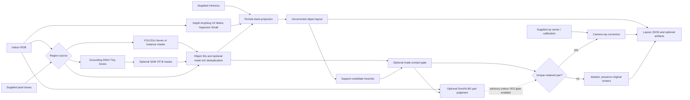
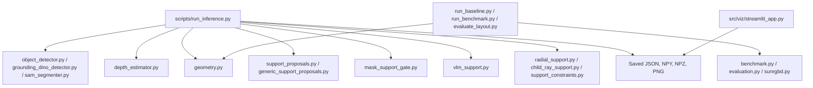
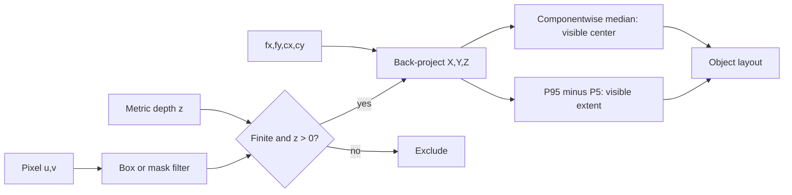
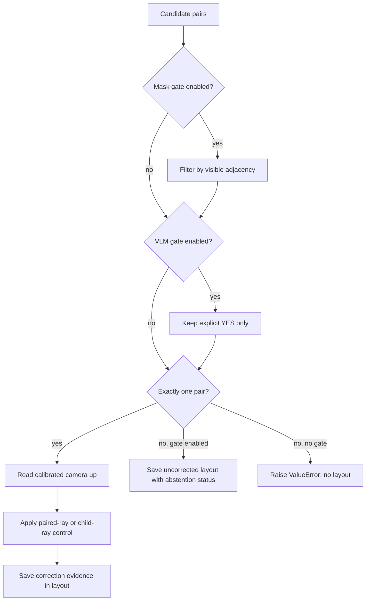
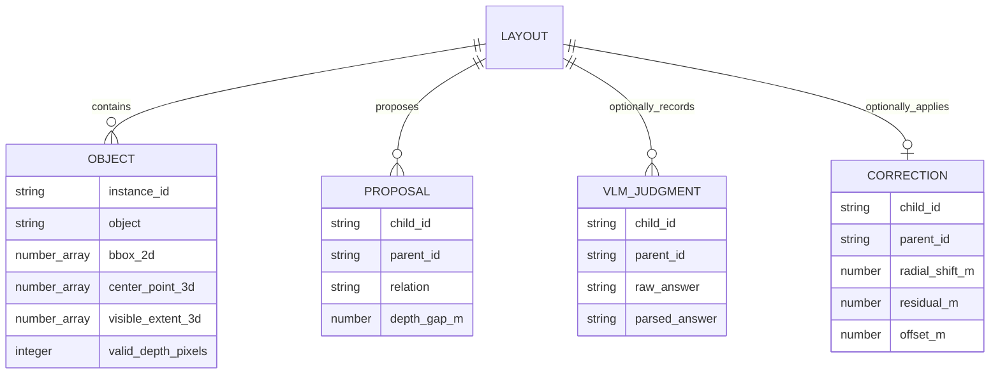
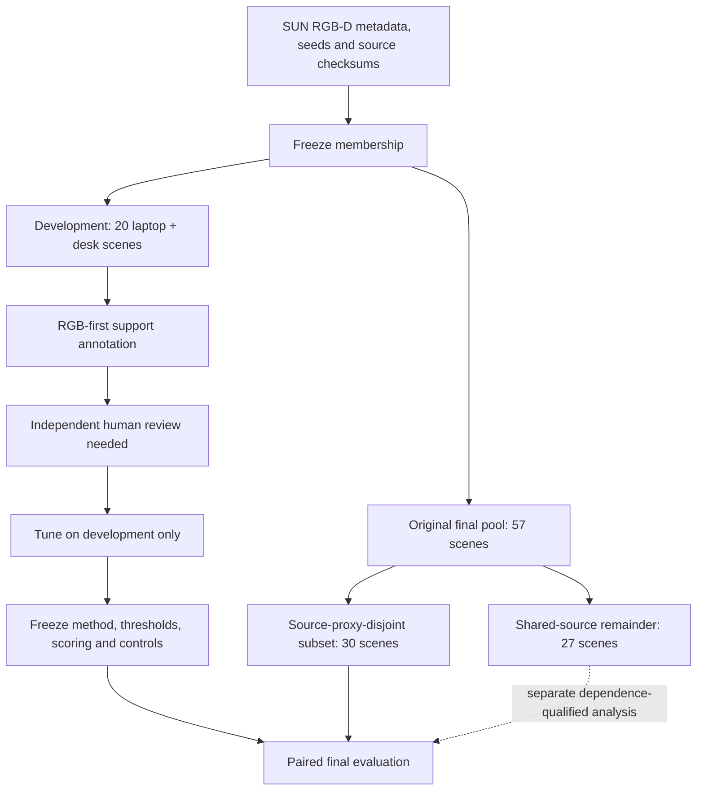

# Single-Image 3D Spatial Grounding and Support-Aware Scene Layout

An executable research prototype that converts **one indoor RGB image plus supplied camera intrinsics** into an object-level 3D layout. It combines object regions, predicted indoor metric depth, camera back-projection, optional support-relation proposals, and optional camera-ray correction. A local vision-language model (VLM) can judge proposed relations, but its answers are advisory by default.

**Research target:** Test whether an observation-dependent support correction with explicit abstention improves child-object center accuracy over uncorrected lifting and the fixed **0.4 m child-ray** control. This gain is **not yet established**. The October 27, 2026 deliverable is a working system and an evidence-supported report, including a negative result if the candidate fails.

> **Status: October 5, 2026.** Geometry, metric-depth inference, Grounding DINO and YOLO region paths, optional SAM masks, support proposals, camera-ray correction, optional SmolVLM2 judgments, evaluation scripts, and a Streamlit viewer exist. Phase 1 development images are prepared. Current development relation labels came from heuristics and a programmatic consistency check; despite a `human_reviewed: true` field, they are **not verified independent human annotations**. The tuned contact threshold is exploratory. Frozen final labels and a validated novelty claim are pending.

The [original README snapshot](docs/original_readme_snapshot_2026-10-05.md) preserves the initial proposal, including its historical Llama/INT4, uncalibrated-image, and 7.5 GB VRAM claims. This README documents the code and evidence now present.

## Contents

- [System boundaries](#system-boundaries)
- [Architecture and model lifecycle](#architecture-and-model-lifecycle)
- [Geometry and support correction](#geometry-and-support-correction)
- [Install and run](#install-and-run)
- [Input and output contracts](#input-and-output-contracts)
- [Research protocol and evidence](#research-protocol-and-evidence)
- [Repository map and limitations](#repository-map-and-limitations)

## System boundaries

The primary input is RGB. The camera's `fx`, `fy`, `cx`, and `cy` must be supplied. A camera-frame up vector or SUN RGB-D calibration is additionally required for radial support correction. The system does **not** self-calibrate arbitrary images. Sensor depth, annotated boxes, and reference 3D centers are diagnostic or evaluation inputs; they do not enter the automatic RGB inference path.

| Stage | Implemented options | What the output means |
|---|---|---|
| Object regions | Supplied boxes, YOLO11n boxes, YOLO11n-seg masks, or Grounding DINO Tiny boxes optionally refined with SAM ViT-B | Detections and masks can miss objects or include background. |
| Dense depth | Depth Anything V2 **Metric Hypersim Small** | Metre-valued indoor prediction; metric output is not a guarantee of metric accuracy. Ordinary relative-depth checkpoints are unsuitable. |
| 3D lifting | Pinhole projection of positive finite depth pixels inside each region | Componentwise median **visible-point** center and robust observed extent, not an amodal center or complete dimensions. |
| Support proposals | Box-footpoint/depth-gap heuristic; optional visible-mask gate | Candidate relations, not verified physical contact. |
| Support correction | Paired-ray or child-only ray control with fixed 0.4 m center-height-gap prior | Heuristic correction; the child-only control is a mandatory research baseline. |
| VLM | Optional local SmolVLM2-2.2B-Instruct YES/NO/UNCERTAIN pair judgment | Advisory by default; the hard YES gate is experimental. |
| Viewer | Streamlit over saved image, depth, masks, layout | Observed geometry and correction evidence, not a full mesh. |

## Architecture and model lifecycle

### End-to-end dataflow



**Control-flow caveat:** `--radial-proposed-support` alone raises `ValueError` for zero or multiple proposals, leaving no layout. When `--mask-contact-gate` or `--vlm-gate` is active, zero or multiple retained proposals save an uncorrected layout with `support_correction_status`. A batch evaluator must record both as abstentions rather than silently dropping those scenes.

### Sequential CUDA execution

The CLI loads detector/SAM, metric depth, and optional VLM stages in sequence and releases earlier model objects between stages. This is a practical memory strategy for the local approximately 8 GB RTX 5060 Laptop GPU, not evidence of general edge deployment.

```mermaid
sequenceDiagram
    participant CLI as run_inference.py
    participant GPU as CUDA
    participant DET as Detector and SAM
    participant DEP as Metric depth
    participant VLM as Optional SmolVLM2
    CLI->>DET: Load checkpoint; infer regions and masks
    DET-->>CLI: Boxes, IDs, labels, masks
    CLI->>GPU: Release detector model and cache
    CLI->>DEP: Load checkpoint; predict H x W depth
    DEP-->>CLI: Metre-valued depth array
    CLI->>GPU: Synchronize and record PyTorch peaks
    CLI->>CLI: Lift points; propose support pairs
    opt VLM enabled and proposals exist
        CLI->>VLM: Load model; query each marked pair
        VLM-->>CLI: Raw text and parsed answer
        CLI->>GPU: Release VLM model and cache
    end
    CLI->>CLI: Correct one eligible pair or abstain
    CLI-->>CLI: Save layout, depth, masks, profile as requested
```

The profile stores stage wall time and PyTorch CUDA allocated/reserved peaks. **Reserved PyTorch memory is not total device VRAM**; CUDA context, other allocators, and other processes need separate accounting. The [VLM pilot](RESEARCH_STATUS_2026-10-04_VLM.md) describes one measured configuration.

### Code boundaries



## Geometry and support correction

### Coordinates and robust lifting

Camera coordinates are **X right, Y down, Z forward**, in metres. Boxes are `[xmin, ymin, xmax, ymax]` in original-image pixels with exclusive maxima. At pixel `(u, v)` and predicted depth `z`:

```text
X = (u - cx) z / fx
Y = (v - cy) z / fy
Z = z
```

Only finite positive depth pixels inside the box or its instance mask contribute. `center_point_3d` is the componentwise median of lifted **visible points**. `visible_extent_3d` is the componentwise 95th minus 5th percentile. Neither is a complete 3D bounding box. An object region without valid depth raises an error.



### Support proposal and child-ray control

The configurable proposal heuristic uses the bottom-center of the child's box, checks whether it falls inside a parent surface box, requires a median-depth gap at most **0.75 m**, and chooses the eligible parent with smallest gap. It is candidate generation, not proof of physical support. The optional mask-contact gate uses visible lower-contour adjacency and can miss occluded contact.

The fixed child-ray control keeps the parent center fixed. Let `c` and `p` be child and parent centers, `r = c/||c||` the child camera ray, `a` unit camera-frame up, `h = 0.4 m` the target center-height gap, and `σc`, `σr` heuristic scale parameters:

```text
innovation = h - dot(c - p, a)
shift = clip( σc² dot(r,a) innovation /
              (σc² dot(r,a)² + σr²), -max_shift, +max_shift )
corrected_child = c + shift r
```

The CLI currently uses `σc = 0.4 m`, `σr = 0.2 m`, `max_shift = 0.5 m`. These are **not calibrated confidence intervals**. The alternative paired-ray control can move both centers. `--support-constraints` is a separate supplied-relations path, not an automatic detector.



The proposed research extension is a **local support-surface target plus observation-dependent reliability and abstention**. It has not yet been validated in the main CLI. Its value must be shown against the simple child-ray control on frozen data.

## Install and run

Commands are for **Windows PowerShell** from the repository root. Use the project `.venv`; system `python` may have different or CPU-only packages. Checkpoints and SUN RGB-D data are large ignored local assets, so installing packages alone does not provide them. See the [results index](results/README.md), [VLM report](RESEARCH_STATUS_2026-10-04_VLM.md), and download scripts for artifact provenance.

```powershell
cd C:\AIML\Research\VLM-Guided-3D-Spatial-Grounding-and-Scene-Dissection
.\.venv\Scripts\python.exe -m unittest discover -s tests -v
.\.venv\Scripts\python.exe scripts\run_inference.py --help
```

### Supplied-depth geometry baseline

```powershell
.\.venv\Scripts\python.exe scripts\run_baseline.py `
  --depth examples\depth.npy `
  --objects examples\objects.json `
  --fx 525 --fy 525 --cx 319.5 --cy 239.5 `
  --output outputs\layout.json
```

The example inputs, if present, are synthetic smoke tests. `run_benchmark.py` accepts a manifest of supplied depth, boxes, references, and intrinsics; it isolates geometry rather than the automatic RGB system.

### Full RGB path: Grounding DINO, SAM, metric depth, and correction

The following is a **previously inspected demonstration** on an official prepared SUN RGB-D scene. It requires the local checkpoints and the prepared scene folder.

```powershell
.\.venv\Scripts\python.exe scripts\run_inference.py `
  --image data\sunrgbd_official\radial_desk7\sunrgbd_007816\image.jpg `
  --grounding-dino-checkpoint checkpoints\grounding-dino-tiny `
  --sam-checkpoint checkpoints\sam-vit-base `
  --checkpoint checkpoints\depth_anything_v2_metric_hypersim_vits.pth `
  --fx 520.532 --fy 520.7444 --cx 277.9258 --cy 215.115 `
  --radial-proposed-support --mask-contact-gate `
  --support-method child-ray-soft `
  --sunrgbd-calibration data\sunrgbd_official\radial_desk7\sunrgbd_007816\calib.txt `
  --depth-output outputs\demo_depth.npy `
  --masks-output outputs\demo_masks.npz `
  --boxes-preview outputs\demo_boxes.png `
  --profile-output outputs\demo_profile.json `
  --output outputs\demo_layout.json --device cuda
```

For another indoor photo, replace its image and **measured intrinsics**. To propose another child class, add e.g. `--grounding-labels bottle table --support-child-labels bottle`. The prompt labels and parent vocabulary limit the candidates.

### Optional VLM and viewer

Add `--vlm-checkpoint checkpoints\smolvlm2-2.2b-instruct` to a proposal-mode command. The layout then records marked-pair raw/parsed judgments without changing geometry. `--vlm-gate` retains only YES proposals and is experimental. In the [12-pair pilot](RESEARCH_STATUS_2026-10-04_VLM.md), YES-only accepted 6/8 visually positive and 1/4 visually negative oracle-box pairs; this small inspected sample does not establish a VLM gain.

```powershell
.\.venv\Scripts\python.exe -m streamlit run src\viz\streamlit_app.py
.\.venv\Scripts\python.exe scripts\evaluate_layout.py `
  --prediction outputs\demo_layout.json `
  --reference path\to\reference.json
```

`evaluate_layout.py` requires compatible camera-frame reference centers and stable IDs. Matched-object error alone does not capture detector misses; report matching coverage separately. The viewer opens saved artifacts through its sidebar.

## Input and output contracts

An `--objects` file is a JSON array. Stable IDs are recommended for evaluation:

```json
[
  {"instance_id": "object_0", "label": "laptop", "bbox_2d": [120, 80, 420, 380]}
]
```

An output layout has the following structure; **numbers below illustrate schema only**, not a measured prediction:

```json
{
  "coordinate_system": "camera_x_right_y_down_z_forward_meters",
  "camera_intrinsics": {"fx": 525.0, "fy": 525.0, "cx": 319.5, "cy": 239.5},
  "objects": [
    {
      "object": "laptop", "instance_id": "object_0",
      "bbox_2d": [120, 80, 420, 380],
      "center_point_3d": [0.1, -0.2, 2.0],
      "visible_extent_3d": [0.4, 0.2, 0.3],
      "valid_depth_pixels": 1234, "region_type": "mask"
    }
  ]
}
```

Optional fields include `proposed_support_relations`, `mask_contact_evidence`, `vlm_support_judgments`, `support_correction_status`, `child_ray_support_correction` or `radial_support_correction`, and an object's `uncorrected_center_point_3d`. `--depth-output` writes metre-valued NPY, `--masks-output` per-ID binary NPZ masks, and `--profile-output` stage times and PyTorch memory peaks.



## Research protocol and evidence

### Split, annotation, and leakage boundaries



The 20-scene development and 57-scene final selections have no shared scene IDs, but the [split audit](results/sunrgbd_phase1_split_audit.json) found seven shared `sequence_name` parent paths covering 27 final scenes. The [derived 30-scene subset](results/sunrgbd_phase1_final_source_disjoint30_selection.json) excludes those paths before final image inspection or scoring. A parent path is a conservative proxy for a room or scan, **not a verified room ID**. The original 57-scene selection remains intact. See the [annotation protocol](docs/phase1_annotation_protocol.md) and its [addendum](docs/phase1_annotation_protocol_addendum.md).

The current `results/phase1_development20_final_annotations.json` is **not an independent human reference**. Its `human_reviewed: true` flag is contradicted by `review_method: programmatic_consistency_check`, and `final_support_label` remains null. The first pass was generated from RGB box heuristics. The reported contact threshold `0.50` and F1 `0.80` measure agreement with those provisional heuristics on development data, not validated physical-support accuracy. Human RGB-first review and uncertainty adjudication are needed before tuning can support a research claim.

The main final comparison should use identical cached predictions and matching for: (A) uncorrected SAM lifting, (B) fixed 0.4 m child-ray control, and (C) any new local/size-aware candidate. The primary estimate is a paired **scene-level** difference in mean child-center error between C and B on the fixed eligible-positive cohort. An abstention retains the uncorrected center **and remains in the denominator**. Report detector and pair coverage, relation precision/recall, false proposals per scene, correction coverage, harmed cases, category results, latency, and memory separately. Sensor-depth and supplied-box tracks are diagnostics, not the automatic RGB result.

### Selected measured observations

| Observation | Scope and caveat | Source |
|---|---|---|
| Median object-center error 0.301 m with sensor depth versus 0.422 m with predicted depth | 20 SUN RGB-D scenes, 93 matched objects, supplied 2D boxes; isolates depth/geometry | [Results index](results/README.md) |
| Two matched positive bottle pairs changed from 0.652 m to 0.486 m mean child-center error after fixed correction | Tiny selected transfer diagnostic, not final validation | [Bottle transfer](RESEARCH_STATUS_2026-10-04_BOTTLE_TRANSFER.md) |
| SmolVLM2 YES-only accepted 6/8 visually positive and 1/4 visually negative oracle-box pairs | Small, previously inspected pilot; no established VLM advantage | [VLM pilot](RESEARCH_STATUS_2026-10-04_VLM.md) |
| CUDA positive scene applied a child-ray shift near -0.237 m | One previously inspected scene; execution evidence, not accuracy evidence | [Kilo progress](KILO_PROGRESS.md) |
| 36 unit tests pass in `.venv` | Code checks, not real-scene validation | `tests/` |

Prior work already combines single-image semantics, depth, 3D lifting, and spatial relations. A potential contribution here is a **specific evaluated support-correction mechanism and abstention policy**, if it beats the strong simple control. Combining backbones or exporting JSON alone is not a novelty claim. See the [research plan](RESEARCH_PLAN.md) and dated reports for historical positive and negative findings.

## Repository map and limitations

| Location | Purpose |
|---|---|
| `scripts/run_inference.py` | One-image RGB-to-layout CLI and optional artifacts/profile. |
| `src/pipeline/geometry.py`, `depth_estimator.py` | Intrinsics, lifting, metric depth. |
| `src/pipeline/object_detector.py`, `grounding_dino_detector.py`, `sam_segmenter.py` | Region discovery, masks, deduplication. |
| `src/pipeline/support_proposals.py`, `generic_support_proposals.py`, `mask_support_gate.py`, `vlm_support.py` | Candidate generation and optional relation filters. |
| `src/pipeline/child_ray_support.py`, `radial_support.py`, `support_constraints.py`, `contact_surface.py` | Correction controls and support geometry. |
| `src/pipeline/sunrgbd.py`, `scripts/fetch_sunrgbd_official_subset.py` | Official dataset conversion and calibrated scene preparation. |
| `scripts/run_baseline.py`, `run_benchmark.py`, `evaluate_layout.py` | Geometry-only and center-error evaluation. |
| `src/viz/streamlit_app.py` | Saved-result viewer. |
| `results/`, `RESEARCH_STATUS_*.md`, `KILO_PROGRESS.md` | Frozen selections, reports, and audit trail. |

**Limits to retain in every claim:** predicted metre values can be wrong; calibration is externally supplied; visible-point centers differ from amodal 3D centers; mask adjacency does not establish physical contact; missed objects reduce coverage; VLM judgments are not an oracle; exploratory inspected cohorts cannot be pooled into an independent benchmark; source-path separation does not prove room independence. Record checkpoint hashes, exact commands, failures, cold/warm timing, and total-device as well as PyTorch memory when making runtime claims. The local working CUDA environment is PyTorch `2.14.0+cu130` and torchvision `0.29.0+cu130` on an RTX 5060 Laptop GPU, but these versions are one verified environment rather than universal requirements.
